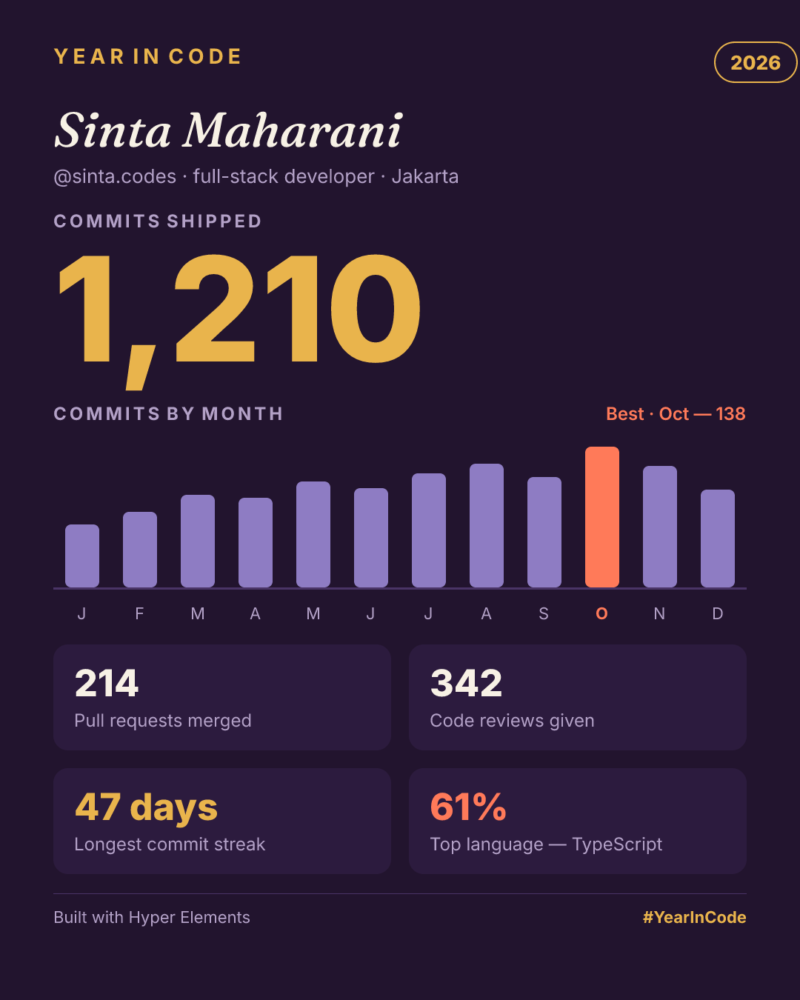

# Year in Code — a year-in-review stats card (Canvas)

A shareable year-in-review card for a fictional developer, **Sinta Maharani**: her commit total as one huge numeral, a bar chart of commits by month with the best month highlighted, and four stat cards (pull requests, reviews, longest streak, top language). Built entirely with [Hyper Elements](https://hyperelements.dev) as a single `<Canvas>` template, rendered to PNG and SVG — the "wrapped" card every developer posts in December, except everything on it is computed from data.



## Run it

```bash
npm install
npm run render     # validates, then writes preview.png, out/year-in-code@2x.png and out/year-in-code.svg
npm run check      # the Hyper Elements CLI check on the template
```

**Checks:** `hyper-elements check` reports **0 errors, 0 warnings**, and `validate()` inside `src/render.tsx` prints no diagnostics.

## How Hyper Elements was used

- **One `<Canvas>` root, 1080 × 1350** — the portrait size social platforms crop best — rendered with `renderImage()` from `@hyper-elements/react/image`. Fonts are passed as bytes (Inter and Fraunces from `assets/fonts/`, both SIL Open Font License); the renderer loads nothing itself, so the PNG and SVG are fully self-contained and deterministic.
- **The card is computed, not drawn.** The monthly commits live in one array at the top of `src/year-in-code.tsx`. The hero numeral is that array's sum (`reduce`), the best month is found with a second `reduce`, and the chart scales every bar against it. Edit the twelve numbers and the total, the bars and the coral highlight all move — nothing is hard-coded to match.
- **The chart is `Svg` primitives.** Twelve `Rect`s positioned and sized in code (rounded tops, a baseline rule), with the best month's bar filled coral instead of lavender. The month initials below are a `Row` of twelve `Text`s, the best month's letter bolded and coral to match its bar.
- **A theme carries the night-market palette.** `defineTheme` sets the deep-aubergine background, cream text, gold primary and muted lavender, the Fraunces italic display face for the name against Inter for everything else, and a named `statCard` style (surface, radius, padding) that every stat card applies.
- **One typed custom component**, defined with `component()` and validated like a built-in: `wrapped.Stat` — a value + label card whose `tone` prop (`cream` / `gold` / `coral`) picks the value's colour. The four cards are mapped from a data array.

## Make it yours

- **Your year:** replace the `MONTHS` and `STATS` arrays and the name/handle lines — the total, chart and highlight recompute themselves.
- **Retint:** the palette is six theme tokens; the two chart colours (lavender bars, coral highlight) sit next to the chart geometry at the top of the file.
- **Reshare at any size:** change the `Canvas` `width`/`height` (1200 × 630 makes the landscape card the library's own examples use) and adjust the padding — the layout is ordinary `Column`/`Row`/`Grid`.

## Files

- `src/year-in-code.tsx` — the template (data, theme, `wrapped.Stat`, the `Svg` chart)
- `src/render.tsx` — validate → render PNG (1x and 2x) and SVG, fonts as bytes
- `assets/fonts/` — Inter and Fraunces TTFs (SIL OFL), embedded into the renders
- `preview.png` — the card at 1080 × 1350 (the 2x PNG and the SVG are written to `out/`)

MIT licensed.
